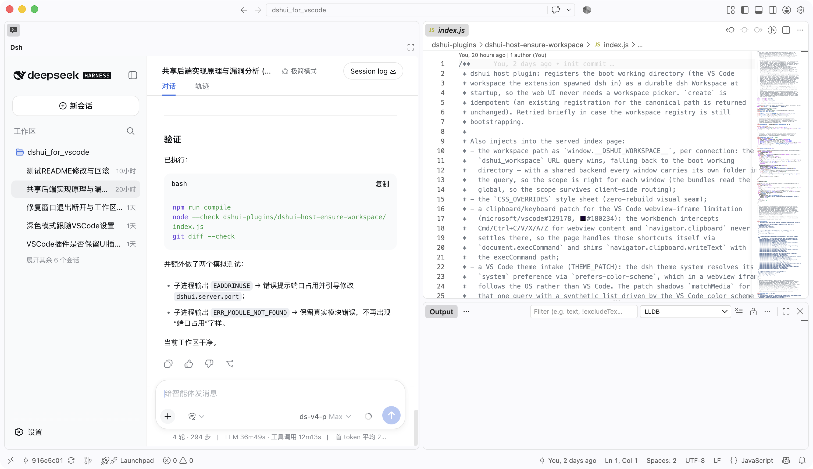
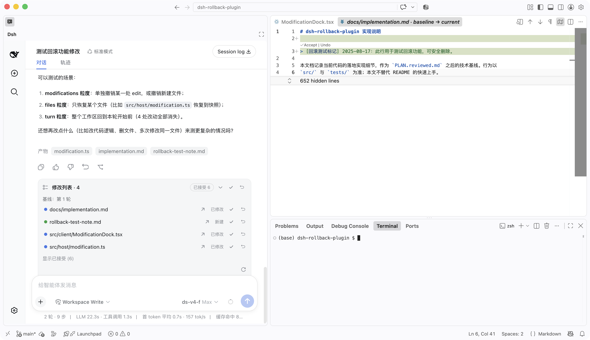

# dsh UI for VS Code

> English · [中文](README.md)

## Table of Contents

- [Introduction](#introduction)
- [Features](#features)
- [Requirements](#requirements)
- [Installation](#installation)
- [Getting Started](#getting-started)
  - [Commands](#commands)
  - [Settings](#settings)
  - [Referencing Files and Code Selections](#referencing-files-and-code-selections)
  - [Opening Files](#opening-files)
  - [Network Links in Messages](#network-links-in-messages)
  - [Multiple Windows (Shared Backend)](#multiple-windows-shared-backend)
  - [Rollback (Reviewing Modifications)](#rollback-reviewing-modifications)
  - [IM Bots](#im-bots)
- [How It Works](#how-it-works)
- [Development](#development)
  - [Three Tiers of Iteration](#three-tiers-of-iteration)
  - [Upgrading with dsh Releases](#upgrading-with-dsh-releases)
- [Important Notes](#important-notes)
- [Contributing](#contributing)
- [Feedback](#feedback)
- [License](#license)

## Introduction

[dsh UI for VS Code](https://github.com/leathong/dshui-for-vscode) is a VS Code extension that embeds
the web UI of [DeepSeek Harness](https://github.com/deepseek-ai/deepseek-harness) (`dsh`, DeepSeek's
open-source agentic coding framework — "everything is a plugin") into the VS Code sidebar, so agent
sessions and your coding workflow live in the same window.

The core idea: **the folder you have open in VS Code IS the dsh workspace**. The extension starts an
embedded `dsh web` server with that folder as its working directory (the dsh CLI ships inside the
extension and runs on your local Node ≥ 22.19 — see [Requirements](#requirements)) and registers it as
a persistent dsh Workspace.
All dsh capabilities — session chat, tool cards, goals, subagents, background tasks — work as-is, with
a deeply integrated VS Code experience on top.

<p align="center">
  
  <br>
  <em>dsh UI embedded in the VS Code sidebar: the opened folder is the workspace, the input box stays
  pinned to the bottom, and the sidebar lists only the current workspace's sessions.</em>
</p>

## Features

Compared with the stock browser UI, this extension differs in five main ways:

1. **No workspace selection.** The opened folder is the workspace: the extension starts the
   `dsh web` server with it as the working directory and registers it as a persistent Workspace, so a
   usable session is available as soon as the view opens.
2. **The sidebar lists only the current workspace's sessions.** Other workspaces, the Ungrouped
   bucket, grouping/sorting view options, and the "add workspace" action are hidden — everything you
   see belongs to the folder you have open.
3. **The input box stays pinned to the bottom.** The centered "new session" hero is removed; the
   composer is fixed at the bottom in every state, like an active session.
4. **Sessions can be deleted directly** (dsh's own archive action stays available in the same menu).
   Deleting is performed by the extension host via the VS Code file API, which removes the session log
   files under `~/.dsh/sessions/...` directly (bypassing dsh's archive RPC; dsh itself is unchanged).
5. **Markdown links in user messages are clickable.** `[label](url)` links over http/https/mailto open
   in the system browser; relative paths (e.g. `[Makefile](Makefile)`) resolve against the session cwd
   and open the file in the current window, while home paths (e.g.
   `~/.dsh/profiles/web/cordis.patch.yml`, also spelled `../~/.dsh/...`) resolve against the account
   home.

Everything else from the dsh web UI is preserved: session chat, tool cards, goals, subagents, settings,
model selection, background tasks, feedback, and more. On top of that, the extension provides several
deep VS Code integrations:

- **Theme following:** `prefers-color-scheme` inside the webview follows the VS Code theme rather than
  the OS, so the **system** preference in appearance settings resolves to "follow the VS Code theme";
  manually choosing dark/light still takes priority. When opened in a system browser, it still follows
  the OS.
- **File opening:** file links in chat open in **the current VS Code** window with no system
  confirmation popup (see [Opening Files](#opening-files)).
- **Referencing files and code selections:** right-click to insert a file reference or the selected
  code into the input box (see
  [Referencing Files and Code Selections](#referencing-files-and-code-selections)).
- **Shared backend across windows:** all windows reuse a single embedded server — no port conflicts,
  consistent session data (see [Multiple Windows (Shared Backend)](#multiple-windows-shared-backend)).
- **Modification rollback:** every file change the agent makes lands in the sidebar "Modifications"
  panel; review each file in a native VS Code diff and accept or undo it (see
  [Rollback (Reviewing Modifications)](#rollback-reviewing-modifications)).
- **IM bots:** the extension ships the third-party plugin
  [`@xmanrui/dsh-im`](https://github.com/xmanrui/dsh-im) (by xmanrui, MIT license, v4.28.0) — scan a
  QR code or enter bot credentials to connect Feishu, WeChat, DingTalk, WeCom, QQ, Slack, Telegram,
  Discord, WhatsApp, iMessage, Email and Matrix bots to dsh, plus the public AI Office connector
  (see [IM Bots](#im-bots)).

## Requirements

- VS Code ≥ 1.105 (bundled dsh ≥ rc7 needs extension-host Node ≥ 22.19; VS Code 1.105+ embeds Node
  22.19, 1.104 and earlier do not satisfy it — `engines.vscode` blocks them at install time, with a
  runtime guard as backstop)
- Node ≥ 22.19 on the machine launches the dsh CLI (auto-detected from `PATH` and the usual
  Homebrew / nvm / fnm / asdf / Volta locations; `dshui.server.nodePath` overrides it). dsh ≥ 0.1.6
  reads Node internals through a native addon during boot, and that addon cannot load inside VS
  Code's Electron runtime, so the server cannot start without a usable Node (the extension then
  degrades to the embedded Electron runtime with a warning — that fallback only works for
  dsh ≤ 0.1.5).
- A local Node ≥ 22.19 and pnpm 11.7.0 are only needed when **rebuilding the client bundles from
  source** (see [Development](#development)).

## Installation

**Option 1: install the prebuilt package** (recommended; ships the dsh runtime, ~60 MB)

Release packages are published on [GitHub Releases](https://github.com/leathong/dshui-for-vscode/releases):

```sh
code --install-extension dshui-for-vscode-0.1.0.vsix
```

**Option 2: package from source**

```sh
npm install
npm run compile                       # TypeScript → out/
npx @vscode/vsce package              # produces dshui-for-vscode-<version>.vsix
```

> Packaging from source does **not** require the upstream source: `.dsh-src/` and `.tools/` are not
> committed and don't exist in a fresh clone; `scripts/copy-clients.mjs` skips them automatically when
> the checkout is missing and uses the prebuilt client bundles shipped with the package.
>
> A dsh upgrade also has to declare every **third-party** dependency of the runtime closure in the root
> `package.json`: `sync-dsh` strips the dependency tables of the `@deepseek-ai/*` copies it writes, so
> only the root manifest can install them. `sync-dsh` (preinstall) checks the declarations and
> `npm run verify:deps` also checks the installed versions (`vscode:prepublish` runs it before
> packaging); a gap leaves the affected plugins at `failed to import` (the 0.1.7 upgrade missed
> `execa`, `@modelcontextprotocol/client` and `@deepseek-ai/libreoffice-kit`).

For development, press **F5** (the repo ships `.vscode/launch.json`), or run
`code --extensionDevelopmentPath="$PWD" <folder>`.

## Getting Started

1. Install the extension (`dshui-for-vscode`).
2. Open a folder — that folder becomes the dsh workspace.
3. The dsh UI appears in the sidebar (activity bar icon → **dsh**); it opens automatically when you
   open a folder (disable with `dshui.autoOpen`, reopen with the **dsh UI: Open** command).
4. Use the input box at the bottom. Sessions persist per folder in your dsh home (`~/.dsh`, shared
   with the browser UI).

### Commands

| Command | Description |
| --- | --- |
| `dshui.open` | Show the dsh UI view in the sidebar |
| `dshui.openInBrowser` | Open the same scoped server in the system browser |
| `dshui.referenceFile` | Insert a file reference into the dsh input box (Explorer / editor / editor tab context menus) |
| `dshui.referenceFolder` | Insert a folder reference into the dsh input box (Explorer context menu) |
| `dshui.referenceSelection` | Insert the selected code (with line numbers) into the dsh input box (editor context menu) |
| `dshui.restartServer` | Restart the embedded dsh server and refresh the sidebar view (also the ⟳ button in the view title bar; equivalent to starting when the server is not running) |
| `dshui.showLogs` | Reveal the dsh UI logs in the Output panel (View → Output → **dsh UI**), for troubleshooting |
| `dshui.rollback.accept` | Accept the modification in the active rollback diff (CodeLens / context menu / command palette) |
| `dshui.rollback.undo` | Undo the modification in the active rollback diff (CodeLens / context menu / command palette) |

> Restarting the server interrupts in-flight agent tasks (session data persists in `~/.dsh` and is not
> lost). Under the shared backend, if the server was started by **another window**, a confirmation
> dialog explains the impact on other windows first; after confirming, this window takes over: the
> original listening process is terminated and a new one is started on the same port as the new owner.
> Other windows keep their URLs and recover automatically after a reload. Use this command to apply
> changes to settings such as `dshui.server.port` immediately, without reloading the window.

### Logs & Troubleshooting

Extension errors, plugin-install results, and the embedded dsh server's own stdout/stderr (including
the api-proxy patch's warnings) are written to the VS Code **Output panel** (View → Output → pick
**dsh UI**, or run **dsh UI: Show Logs** from the Command Palette). Lifecycle events — server
start/exit, shared-backend registration, the open bridge, the update check — are recorded there too.
When the server fails to start, the error notification offers a **View Logs** action that opens the
panel directly.

The same log lines (timestamp + level prefix) are also appended to
`~/.dsh/dshui-logs/extension.log` (under your dsh home) for headless/CLI debugging, and uncaught
exceptions and unhandled promise rejections inside the extension host are recorded as well.

The startup line `launching dsh web with system Node.js v… (…)` names the Node actually used. When no
usable Node is installed, a `no system Node.js >= 22.19.0 found …` warning appears first and dsh then
fails with `host preparation failed: node-addon-require-builtin unsupported: Unsupported/no-realm`
(newer addon builds may instead report `Unsupported/no-context` plus `unsupported Electron runtime
fingerprint`): install Node.js ≥ 22.19 (or point `dshui.server.nodePath` at a Node binary) and run
**dsh UI: Restart dsh Server** — no window reload needed.

### Settings

| Setting | Default | Description |
| --- | --- | --- |
| `dshui.autoOpen` | `true` | Automatically show the sidebar view when a folder is opened |
| `dshui.server.port` | `61370` | Port of the embedded server. The fixed port doubles as the shared-backend rendezvous: all windows reuse ONE server (each scoped via `?dshui_workspace`), and localStorage is scoped per workspace so each folder remembers its own last-opened session across launches. Set to `0` for an OS-assigned port (no sharing, no persistence). If the fixed port is taken, startup reports an error and asks you to change the port (no random-port fallback) |
| `dshui.server.nodePath` | empty | Node ≥ 22.19 binary used to launch the dsh CLI. Empty = auto-detect (`PATH`, then Homebrew / nvm / fnm / asdf / Volta / Program Files locations); `electron` = force VS Code's embedded Electron runtime (only works for dsh ≤ 0.1.5). Run **dsh UI: Restart dsh Server** after changing it |
| `dshui.openFilesInVscode` | `true` | Open file links from chat in **the current VS Code** window (via the extension's bridge, no system popup) instead of the OS default editor |
| `dshui.checkDshUpdates` | `true` | Check the npm registry for newer dsh releases at startup and notify when the bundled version is outdated (throttled to once per 24h; each new version is announced once; can be disabled) |

### Referencing Files and Code Selections

Right-click a file or **folder** in the **Explorer**, or right-click an **editor tab** →
**Add File to dsh** / **Add Folder to dsh**; or select code in the **editor** and right-click →
**Add Selection to dsh**. The reference is inserted into the sidebar input box as message text (the
sidebar view is focused automatically):

- File / folder reference: `[src/extension.ts](src/extension.ts)` / `[src/components/](src/components/)` —
  a standard markdown link (relative path). The agent reads or lists the target with its own tools, so it
  costs no input-box space.
- Code selection reference: `[src/extension.ts#L10-L20](src/extension.ts#L10-L20)` + a code block —
  the path, line numbers (GitHub-style `#Lx-Ly` anchors), and the selected code are handed to the
  agent together. Very long selections (> 20,000 characters) are truncated with a note pointing to the
  full path.

References are not lost while the panel is still starting up: the webview shell buffers them and writes
them into the draft once the dsh SPA is ready; while the input box is busy (submitting), insertion
waits until it is writable again.

### Opening Files

File links in chat open in **the current VS Code** window by default, with **no system confirmation
popup**:

- The extension runs a local HTTP bridge (127.0.0.1, random port, lifecycle tied to the extension) and
  applies an idempotent patch to the api-proxy so "open file" requests are handed to the bridge, which
  opens the file via the **VS Code API**.
- A link destination resolves in one of two spellings: a workspace-relative path (including `./`/`../`)
  is joined onto the **session cwd**, while a home-relative path (`~`, `~/…` — also when wrapped in
  `./`/`../` prefixes, which cannot rise above that anchor and are dropped) is expanded against the
  account home by the server. The browser cannot read the home directory, so such a destination keeps
  its `~` spelling for the host instead of becoming `<cwd>/~/.dsh/...`.
- **Absolute paths** also open — including a file an agent wrote into a temporary area (`/tmp/…`,
  `$TMPDIR/…`). The host verifies them through `realpath`, so a symlinked spelling (macOS `/tmp` →
  `/private/tmp`, `$TMPDIR` → `/private/var/...`) is no longer rejected as
  "Path has no verified Host path".
- Under the shared backend, each window registers its workspace and bridge in
  `$DSH_HOME/dshui-bridges.json`. The patch prefers the **window where the click happened**: the client
  attaches the session's workspace directory to the open request (`dshuiOrigin`), and when that
  workspace contains the target path the open is routed to the clicking window's bridge; otherwise it
  routes by "longest-prefix workspace of the opened path" to the bridge of **the window where the file
  was clicked**. Nested workspaces (the outer folder and a subdirectory open as separate windows)
  therefore also open in the window you clicked in, instead of always being pulled into the child
  window by the longest prefix. Edge cases (paths outside any workspace, multiple windows on the same
  directory) fall back to the owner's bridge.
- When the bridge is unavailable, the fallback chain is: the `code` CLI (in-app paths are passed to the
  server via `DSHUI_CODE_CLI`, which opens the running VS Code through the CLI socket protocol, also
  without a confirmation popup) → `open vscode://file/...` (with a confirmation popup).
- **Text vs non-text is detected automatically**: the bridge first reads the extension (images, PDFs,
  archives, audio/video, executables, fonts, …) and otherwise applies VS Code's own rule to the first 512
  bytes (a NUL byte means binary; a UTF-16 BOM and the "every other byte is zero" BOM-less UTF-16 are the
  exceptions, so a legacy encoding such as GBK still opens as text). Non-text files go through
  `vscode.open` instead: **images open in the built-in image preview**, every other binary in VS Code's
  binary viewer — those files used to be rejected outright by `showTextDocument`, leaving only a
  "File seems to be binary and cannot be opened as text" line in the log. If `vscode.open` fails too, the
  OS default application is used. Line targeting (`#L10`, `:10`, …) applies to text files only.
- `.html` / `.pdf` still open in the system browser; disable with `dshui.openFilesInVscode` (restores
  the OS default handler).

### Network Links in Messages

**http/https links** (including `mailto:`) in chat messages open in the **system browser** by default.
dsh renders these links as `<a target="_blank">`, which opens a new tab in a normal browser but is
blocked by the VS Code webview (no `window.open`/popups), so clicks used to do nothing. A capture-phase
click interceptor in the injected host-plugin script now routes such clicks: click → relayed through the
webview shell → extension host → `vscode.env.openExternal` opens the system browser. Modifier clicks
(Cmd/Ctrl/Shift/Alt+click) are left to VS Code's own handling; non-http(s) destinations (e.g.
`javascript:`) are not intercepted.

### Multiple Windows (Shared Backend)

The fixed port (default 61370) doubles as a rendezvous: when a second window activates, it probes the
port and, if a dshui server is already there, reuses it instead of starting a new process. It registers
its own folder through a marker in `$DSH_HOME/dshui-workspaces/`, and the webview connects with
`?dshui_workspace=<folder>`; the host plugin resolves scope per connection. Lifecycle:
`$DSH_HOME/dshui-server.json` records the pid of the window using the server, the server starts
detached (it outlives the window that started it), the host plugin polls the registry and exits when no
window is alive. An adopter that finds no registry yet (the owner window is still registering during
startup) creates it and registers itself instead of being silently dropped, and the owner's close-time
check decides by the registry whether other windows are still using the server — the startup race no
longer stops the shared server under the other windows. As a result, windows over the same or different
workspaces share one backend, only one
process ever writes to `~/.dsh`, there are no more EADDRINUSE conflicts, and the multi-process shared
disk-state warning from dsh's upstream README is avoided.

Notes:

- **File opening:** each window registers its own bridge (`dshui-bridges.json`, cleaned by pid
  liveness), and the patch routes by "click origin first → longest workspace prefix → owner bridge".
  The client attaches the session's workspace directory to the open request (`dshuiOrigin`); when the
  target path lies inside it, the file opens in **the window where it was clicked** — with nested
  workspaces (outer folder and a subdirectory open as separate windows), clicking a child-workspace
  file from the outer window opens it there instead of being pulled into the child window. Otherwise a
  file opens in **whichever window** its workspace belongs to. Edge cases fall back to the owner's
  bridge: paths not under any registered workspace (e.g. `/tmp/...`), or two windows on the same folder
  (indistinguishable; the most recently registered one wins). When the owner closes and its bridge is
  gone, the fallback is the `code` CLI (opens in the **most recently focused** VS Code window, no
  popup), then `vscode://file` (with a confirmation popup).
- **Per-workspace localStorage:** an injected patch namespaces every localStorage key by the
  workspace scope (resolved from `?dshui_workspace`), so each workspace remembers its own last-opened
  session and view state and never sees another workspace's. Windows on the same folder still share
  (reload restores within the workspace); a plain browser hit on the server root without a workspace
  query keeps stock unscoped behavior.
- Sharing only applies on the fixed port (the default); with `dshui.server.port = 0`, every window
  starts its own server on a random port.

### Rollback (Reviewing Modifications)

The extension ships `dsh-rollback-plugin`, which records every `write` / `edit` the agent makes to
workspace files during a session (against the session's baseline snapshot) as "unaccepted
modifications", so you can review each one in a **native VS Code diff** and choose to **accept** or
**undo** it — a capability the stock dsh does not have:

- **The Modifications panel:** once the agent has made changes, a collapsible "Modifications" panel
  appears in the conversation view listing only the modified, unaccepted files (with the unaccepted
  count and baseline turn). Each file row offers "open in editor", "accept this modification", and
  "undo this modification" (undo asks for confirmation); the panel header has "Accept all" / "Undo
  all" and a "show accepted" toggle.
- **Native diff review:** clicking a file row opens it in a **native VS Code diff editor** (baseline
  on the left, current content on the right, with real syntax highlighting). **Accept / Undo** CodeLens
  buttons render above each changed hunk; you can also right-click inside the diff → **Accept This
  Change** / **Undo This Change**, or invoke `dshui.rollback.accept` / `dshui.rollback.undo` from the
  command palette.
- **Real on-disk effect:** Accept / Undo call the dsh rollback RPC directly — Accept writes the change
  into the workspace and removes it from the unaccepted list; Undo restores the file to the session
  baseline. After a successful operation the panel refreshes automatically and the now-stale diff
  closes.
- **Undo is whole-file:** undoing a file restores it entirely to the session baseline (turn N
  snapshot); later modifications to that file are lost too. Both the panel and the confirmation dialog
  make this explicit.

<p align="center">
  
  <br>
  <em>Rollback: after clicking a file in the sidebar "Modifications" panel, accept or undo each hunk in
  a native VS Code diff.</em>
</p>

### IM Bots

The extension ships the third-party plugin [`@xmanrui/dsh-im`](https://github.com/xmanrui/dsh-im)
(**source: [github.com/xmanrui/dsh-im](https://github.com/xmanrui/dsh-im), by xmanrui, MIT license**;
v4.28.0, distributed with the extension — see `LICENSE` and `THIRD_PARTY_NOTICES.md` in the plugin
directory), which connects IM bots to dsh:

- **One settings entry:** open **Settings → Plugins → IM Bots** in the dsh UI to connect and manage
  Feishu, WeChat, DingTalk, WeCom (smart bot / self-built app), QQ, Slack, Telegram, Discord,
  WhatsApp, iMessage, Email (IMAP/SMTP and Agent mailbox) and Matrix (experimental) — twelve channels,
  each supporting **multiple bots** — plus the public AI Office connector. Credentials/tokens are
  submitted only to the local Harness Host and written to the protected credential store — status
  endpoints never return them.
- **IM as a session frontend:** messages received by a bot are processed by Harness and answered with
  streaming replies. Each bot keeps its own Harness workspace, model and session binding;
  `/workspace`, `/workspacelist`, `/sessionlist`, and `/session` commands switch workspaces and bind
  sessions.
- **Leave mode (Feishu):** send `/leavemode on` in the dsh UI session input to enable it globally
  (`/leavemode off` disables, `/leavemode` shows the status). The plugin then watches all sessions and
  pushes **questions, approvals, and final results** to Feishu — questions/approvals arrive as
  interactive cards you answer by tapping a button or quote-replying, so work keeps moving while you're
  away from the computer. Pushes are labeled with the workspace name; sessions that belong to no bot's
  workspace are pushed by the most recently active bot as a fallback, and quote-replying any pushed
  message switches the current Feishu conversation to that message's session.
- **Runtime dependencies ship with it:** its host bundle keeps `qrcode`, `dingtalk-stream`, the
  `@tencent-connect/*` and `@wecom/aibot-node-sdk` SDKs, `imapflow`, `mailparser`, `nodemailer`,
  `undici` and `@matrix-org/olm` external, so `make stage-deps` stages a pruned production
  `node_modules/` (~12.8 MiB) into the plugin directory and `installPlugins()` installs it next to
  `lib/` — no `npm install` on the user's machine. Two optional capabilities are deliberately left
  out: with `sharp` absent, inbound images above the model's limit are saved to the workspace and the
  model is told to read them with tools; without `@tencent-qqmail/agently-cli`, the Email Agent
  mailbox reports a missing CLI while plain IMAP/SMTP mailboxes keep working.
- **Updating:** the plugin's built-in "Update" panel manages a copy installed into the profile by
  `dsh plugin add` (it checks npm for newer releases); the copy distributed with this extension is not
  on that path, so the panel reports it as not updatable — update it by updating the extension, which
  reinstalls the bundled copy on every activation.
- **Security note:** a bot's visibility scope IS the inbound access scope — only expose bots to trusted
  tenants, organizations, groups, or members. Per-channel onboarding flows and further security notes
  are in the [upstream README](https://github.com/xmanrui/dsh-im#readme).

## How It Works

```
VS Code sidebar view (webview)
  └── <iframe src="http://127.0.0.1:<port>">     ← stock dsh SPA (independent browser semantics)
        └── talks to the dsh server started by the extension via /api
```

- **Server:** the extension bundles the real `@deepseek-ai/dsh` CLI as a runtime dependency and starts
  `dsh --profile web` with the opened folder as cwd (port: see `dshui.server.port`, fixed 61370 by
  default; pre-started at activation to avoid a blank view while loading).
- **Restoring the last session:** localStorage keys are scoped per workspace (see the note above), so
  each folder restores its own last session on the next launch; with no history, it falls back to a
  blank new session. When the fixed port is taken, startup reports an error and asks you to change the
  port (no random-port fallback).
- **Plugin loading:** on activation, the bundled plugins are installed into
  `$DSH_HOME/profiles/node_modules` (with the extension's own `node_modules` as a loader fallback) and
  wired in through the `--patch` overlay (see `patch.yml`):
  - `dshui-host-ensure-workspace` — the host plugin: registers the working directory as a Workspace at
    startup and injects `window.__DSHUI_WORKSPACE__` (the scope path), a `CSS_OVERRIDES` rebuild-free
    style overlay (including font-size normalization), a VS Code theme takeover patch (shadow
    `matchMedia`; see the "Theme following" bullet below), a Cmd/Ctrl+C copy handler (the VS Code
    webview intercepts copy shortcuts inside iframes — see
    [microsoft/vscode#129178](https://github.com/microsoft/vscode/issues/129178) and
    [microsoft/vscode#180234](https://github.com/microsoft/vscode/issues/180234)), a Cmd/Ctrl+N new
    session handler (intercepts the workbench "New Window" shortcut and routes it to the sidebar "New
    Session" button), and a file/code reference writer (receives reference messages forwarded by the
    webview shell from the extension's context-menu commands and writes them into the composer draft).
  - `dshui-client-ui-workspace` / `dshui-client-ui-conversation` — **rebuilt artifacts** of the two
    stock client packages (the patch renames their tsdown bundle id to the dshui name; `patch.yml`
    disables the stock `ui-workspace` / `ui-conversation` rows and inserts fresh rows under those
    names, and `scripts/copy-clients.mjs` copies the build into `dshui-plugins/`). They carry the
    sidebar filtering, the bottom-pinned input box, and the "Delete Session" menu (deletion goes
    through the webview shell → the extension host via the VS Code file API). The hard constraint is
    that **a row id must equal the id declared inside its bundle by
    `window.__ModuleLoader__.load({ id })`** — dsh 0.1.7's client loader keys factories by the
    declared id, so a mismatch makes the whole row unloadable; and once that row is gone the
    `uiWorkspace` / `uiConversation` services it provides vanish, leaving 20+ client plugins
    injecting them PENDING forever (**Failed to load plugins** in the browser). Rebuild with
    `pnpm run build:lib:client` before copying (a stale build still declares the upstream
    `@deepseek-ai/...` id); `copy-clients.mjs` verifies the id and fails loudly on a mismatch.
  - `dshui-host-workspace-changes-stub` — the host plugin that stands in for the disabled official
    per-turn change recorder (`@deepseek-ai/dsh-workspace-changes`, which renders the "Edited N files"
    card and the change-review tab): `patch.yml` disables that row, and this plugin supplies the empty
    `workspaceChanges` service it left behind. The pairing is mandatory — without the service the Host
    half of the stock `ui-deliverables` stays PENDING forever, silently taking the present delivery
    cards, the native opens, the closing-message file mentions and the deliverable file-reference
    system-prompt section with it. `scripts/verify-overlay.mjs` enforces the pairing at package time
    (a disable must have its replacement, and the replacement must exist). The "Modifications" list
    therefore has exactly one source: the `dsh-rollback-plugin` dock.
  - `dsh-rollback-plugin` — the modification-rollback plugin: records the agent's `write` / `edit`
    modifications and the session baseline snapshot, and provides the "Modifications" dock and native
    diff review (see [Rollback (Reviewing Modifications)](#rollback-reviewing-modifications)).
  - `@xmanrui/dsh-im` — the third-party IM bot plugin (**source:
    [github.com/xmanrui/dsh-im](https://github.com/xmanrui/dsh-im), by xmanrui, MIT license**):
    connects bots from twelve channels (Feishu, WeChat, DingTalk, WeCom, QQ, Slack, Telegram, Discord,
    WhatsApp, iMessage, Email, Matrix) plus the public AI Office connector to dsh (see
    [IM Bots](#im-bots)). Its host bundle declares `qrcode`, `dingtalk-stream`, the qqbot/WeCom SDKs,
    `imapflow`, `mailparser`, `nodemailer`, `undici` and `@matrix-org/olm` as external runtime
    dependencies, so the plugin directory ships a pruned production `node_modules/` (~12.8 MiB) that
    `installPlugins()` installs along with `lib/`.
- **Deleting sessions:** dsh itself offers "archive" (hide the session, keep the files) but has no
  delete RPC. The plugin **adds** a "Delete Session" entry to the session row menu and its hover
  actions (since 0.1.7 upstream moved the row actions into slot entries, so delete sits beside the
  stock archive/pin entries): on click, the plugin posts a message to the webview shell
  (`dshui:deleteSession`, with the session id
  and its workspace directory), and the shell forwards it to the extension host. The host resolves the
  session directory using dsh's session path rules (`$DSH_HOME/sessions/<encoded workspace dir>/<session
  id>/`, matching the `projectKey`/`encodeSegment` of `dsh-session-persistence-jsonl`) and deletes its
  log files with the **VS Code file API** (`vscode.workspace.fs.delete`, recursive), then reports the
  result back through the shell (`dshui:sessionDeleted`). On confirmation the plugin hides the row (the
  session is gone by the next `session.list`); if the deleted session was the current one, it returns
  to the "new session" view. Outside VS Code (e.g. opened in a system browser) or when the host is
  unresponsive (15-second timeout), deletion fails and the row is kept.
- **Theme following:** `prefers-color-scheme` inside the webview iframe normally follows the OS, which
  may disagree with the VS Code theme (`workbench.colorTheme`). On every view load and theme change,
  the extension passes the current color scheme (Dark/HighContrast → dark, everything else → light) to
  the SPA through the shell and the `dshui_theme` URL parameter; the host plugin's injected patch
  shadows `matchMedia` for that one query — so the **system** preference in appearance settings
  resolves to "follow the VS Code theme" instead of the OS; manually choosing dark/light still takes
  priority. Opening in a system browser (`dshui.openInBrowser`) carries no such parameter and still
  follows the OS.

## Development

### Three Tiers of Iteration

The webview renders the **stock dsh SPA** (upstream code from the deepseek-harness repository); the
sidebar/input-box changes are not upstream — they live in two "client plugin bundles" that are rebuilt
from the upstream client packages with the dshui changes injected, shipped as **prebuilt artifacts**
(`dshui-plugins/`), and loaded by the dsh server from installed packages.

Changes to the upstream source are published with the repo as a patch:
`patches/dshui-bundles.patch` (48 files covering `ui-workspace` / `ui-conversation` / `ui-chat`
and their tests, plus the host file-opener, browser-redirect, and fork-inherited-queue runtime
changes; base commit is pinned — see `patches/README.md` for the apply steps). Upstream source
(`.dsh-src`) and build tooling (`.tools/`) are **not committed to git**.

| What to change | Where | Rebuild needed? |
| --- | --- | --- |
| Extension logic (server, webview, commands, settings) | `src/*.ts` | `npm run compile`, then F5 |
| **Visual tweaks** (spacing, colors, bottom pinning, hidden elements) | `dshui-plugins/dshui-host-ensure-workspace/index.js` → the `CSS_OVERRIDES` list | **No** — just reload the window |
| Client behavior (filtering, hero flow, component logic) | `.dsh-src/packages/client/ui-workspace` / `ui-conversation` (TypeScript; fetch the source per `patches/README.md` first) | Full client rebuild (below) |

After editing the browser scripts injected into the page from
`dshui-host-ensure-workspace/index.js` (reference writing / theme takeover), run the built-in behavior
smoke tests before reloading the window:

```sh
node scripts/check-reference-patch.mjs && node scripts/test-reference-patch.mjs
node scripts/check-theme-patch.mjs && node scripts/test-theme-patch.mjs
```

Day-to-day changes to extension logic or styles do **not** require the source checkout; only
structural changes to the dsh client code need a full rebuild:

```sh
# 0. Fetch the upstream source and apply the dshui patch (source is not committed;
#    base commit and full commands are in patches/README.md)
git clone https://github.com/deepseek-ai/deepseek-harness.git .dsh-src
cd .dsh-src
git fetch origin <base commit from patches/README.md> && git checkout FETCH_HEAD
git apply ../patches/dshui-bundles.patch   # fails safely if the base commit mismatches
cd ..

# 1. Build the changed client bundles from source
cd .dsh-src
pnpm clean
pnpm install                      # requires pnpm 11.7.0, Node ^22.19 || >=24
pnpm run build:lib:host           # generates the shared /remote modules
pnpm run build:lib:client         # compiles and packages all client packages
cd ..

# 2. Copy the new bundles into the extension's plugin packages
node scripts/copy-clients.mjs

# 3. Compile the extension and launch the Extension Development Host
npm run compile
code --extensionDevelopmentPath="$PWD" <folder>
```

> `.dsh-src/` (~1.6 GB) and `.tools/` are not committed to git and do not exist in a fresh clone. They
> only matter when rebuilding the client bundles: fetch them per `patches/README.md` and delete them
> anytime — the runtime reads the prebuilt artifacts in `dshui-plugins/`. Removing them only costs you
> the ability to modify client behavior again.

### Upgrading with dsh Releases

At startup the plugin asynchronously compares the latest `@deepseek-ai/dsh` on npm with the bundled
version (controlled by `dshui.checkDshUpdates`, on by default; throttled to once per 24h, each new
version announced once) and notifies when the bundled version is outdated — but the notification is
only a hint; upgrading still requires manually repackaging and reinstalling the extension via the full
workflow below.

The extension binds two dsh versions together, and both must be aligned on upgrade:

1. **CLI runtime:** `dependencies["@deepseek-ai/dsh"]` in `package.json` (currently `0.1.7-rc.2`).
2. **Client bundle source:** the `.dsh-src` checkout (currently `dsh-v0.1.7-rc.2` with the dshui
   client patch re-applied — since 0.1.2 the session/chat clients were restructured, so re-apply the
   patch to the new structure per `scripts/verify-patches.mjs`; since the repo's master may lag behind
   the npm release, align by checking each package's version in its `package.json` and confirm with
   real runtime tests).

Upgrade steps:

```sh
# 0. (Optional) Re-checkout source aligned with the target version — the base commit is pinned to the
#    value in patches/README.md
#    git clone https://github.com/deepseek-ai/deepseek-harness.git .dsh-src
#    cd .dsh-src && git fetch origin <base commit> && git checkout FETCH_HEAD && git apply ../patches/dshui-bundles.patch

# 1. Upgrade the bundled CLI
npm install @deepseek-ai/dsh@<new version>

# 1b. Rebuild the source checkout. On a rebase you MUST clean first: the previous version's stale
#     typert remote declarations in each package's lib/types and *.tsbuildinfo otherwise make tsc -b
#     reuse them and raise dozens of bogus "remote method does not exist" errors.
cd .dsh-src && pnpm install && pnpm run clean \
  && pnpm run build:lib:host && pnpm run build:lib:client \
  && pnpm run gen-client-catalog

# 2. Check that the patch is still complete — the core step
node scripts/verify-patches.mjs      # each file flagged as missing needs its patch re-applied
#    The changes are frozen in patches/dshui-bundles.patch: if it applies cleanly to the base
#    commit, use it as-is; if it drifted, re-apply per the checklist in step 3 and re-export with
#    (--binary is not optional — see below):
#    git -C .dsh-src diff --binary <base commit> > patches/dshui-bundles.patch
#    The base commit must equal Makefile's DSH_BASE and the SHA in patches/README.md: exporting
#    against a stale base swallows the whole upstream delta (the rc.1-based export was 3447
#    files / 15.2 MB) and makes the patch unusable.

# 3. Re-apply any missing patches per the checklist below (the changes are small; follow the comments
#    in each file)
#    - ui-workspace/src/client/tree.ts                 scopedWorkspacePath, scope/deletedSessionIds params on the derives
#    - ui-workspace/src/client/rows/WorkspaceBrowser.tsx  scopedWorkspacePath + useDeletedSessions wiring, deleted-row hiding
#    - ui-workspace/src/client/contract/slots.ts       DeleteSessionInjected and the deletedSessions observable
#    - ui-workspace/src/client/index.ts                deleted-sessions store + deleteSession postMessage
#    - ui-workspace/src/client/session-actions/DeleteSession.tsx  since 0.1.7 row actions are slot entries: register "Delete Session"
#    - ui-workspace/src/client/locales.ts              add menu.deleteSession / actions.delete
#    - ui-workspace/tsdown.config.ts                   bundle id → dshui-client-ui-workspace
#    - ui-conversation/src/client/skeleton/dshui-scope.ts          SCOPE constant (DSHUI_SCOPE)
#    - ui-conversation/src/client/skeleton/ConversationMainPanel.tsx  data-dshui-scope root marker
#    - ui-conversation/src/client/skeleton/ConversationContent.tsx    static chip, hero hiding, scope keeps the composer live
#    - ui-conversation/src/client/skeleton/EmptyHero.tsx              staticChip prop for WorkspaceChip
#    - ui-conversation/src/client/skeleton/ConversationRoot.module.css  scoped hero pinned to the bottom
#    - ui-conversation/src/client/skeleton/HeroShell.module.css       .workspaceStatic
#    - ui-conversation/tsdown.config.ts                bundle id → dshui-client-ui-conversation
#    - ui-chat/src/client/chat/MessageItem.tsx         UserMessageNodeView / SteeringMessageNodeView split, user-actions child slot, markdown link projection
#    - ui-chat/src/client/chat/register-node-renderers.ts  user declares the user-actions child; steering uses the strip-free renderer
#    - ui-chat/src/client/contract/slots.ts            UserActionOwnerProps and the conversation.chat.user-actions slot
#    - packages/client/tsdown.client.ts                workspaceManifest resolves dshui-client-* ids by package directory (rc.1 validates by package name)
#    - packages/util/native-command/src/path-opener.ts  darwin bridge/CLI/vscode://file branch + dshuiOrigin
#    - packages/client/connection/src/browser-auth.ts   keep dshui query params through the token redirect (0.1.7 base is ./)
#    - packages/api/session-controller/src/{index,types}.ts  openWorkspacePath threads dshuiOrigin; verifyDesktopPath expands ~ via dshuiHomePath
#    - packages/api/settings-controller/src/index.ts         openSettingsDocument(dshuiOrigin, signal)
#    - packages/client/ui-chat/src/client/apply.ts           client attaches the window scope (dshuiClickOrigin); dshuiOpenPath owns the link destination spelling (relative → session cwd, home → ~ kept)
#    - packages/mcp/mcp-client/src/index.ts                  startup: eager|lazy

# 4. Rebuild and copy in
pnpm run build:lib:host && pnpm run build:lib:client   # inside .dsh-src
pnpm run build:web                                     # browser shell (do not skip — see the drift list)
pnpm run gen-client-catalog                            # the slot catalog is generated; never hand-edit
node scripts/sync-dsh.mjs
node scripts/copy-clients.mjs                          # patches the two UI bundles into that closure (after sync)

# 5. Recompile the extension and package
npm run compile && npx @vscode/vsce package
```

Other drift-prone spots to check after every upgrade:

- **The `@deepseek-ai/dsh-web-frontend` browser shell (`apps/web/dist`) must be rebuilt:** `pnpm run
  build:lib` builds the host/client libraries but **not** `pnpm run build:web`. The shell is the page
  client plugin bundles run in, and it bundles the shared modules they `require` at runtime (`react`,
  `@deepseek-ai/dsh-client-ui-slots`, `@deepseek-ai/dsh-client-ui-primitives`, ...). A shell left at the
  previous release makes every new plugin fail to load: the browser reports **Failed to load plugins**
  (typically `settingsNumberField is not a function`, because the 0.1.7 settings cards call APIs the old
  shell does not export) while the host logs look perfectly healthy. `scripts/sync-dsh.mjs` now checks
  freshness and refuses to sync when `dist` is older than `src`, printing
  `cd .dsh-src && pnpm run build:web` (set `DSHUI_ALLOW_STALE_WEB=1` to bypass).

- **Build order: `build:lib:host` → `build:lib:client` → `build:web` → `sync:dsh` → `copy:clients`**:
  - the host build also regenerates typert's `lib/typert.remote-client.d.ts`. Running only
    `build:lib:client` leaves the client with the old signature (e.g. `openSettingsDocument(signal?)`),
    so a patched call site such as `openSettingsDocument(dshuiOrigin, signal)` fails to type-check —
    always run the host build first after changing a host service signature.
  - `copy:clients` asserts that the built bundle registers the `dshui-client-ui-*` id: a mismatch means
    the client packages were not rebuilt (the bundle still carries the upstream id), in which case the
    row cannot load and drags 20+ dependents down with it — the script fails instead of packaging it.
  - the UI replacement works by renaming the bundle id, disabling the stock rows, and inserting fresh
    rows; keeping the stock rows and only swapping their file would make the patch's row-name/package
    mismatch skip those rows entirely.

- **The host part of `patches/dshui-bundles.patch`**: it targets the darwin-open branch of
  `packages/util/native-command/src/path-opener.ts`, the token-exchange redirect in
  `packages/client/connection/src/browser-auth.ts`, and the step in
  `packages/api/session-controller/src/commands.ts` that clears a forked child's inherited queue, and
  it depends on the server environment variables `DSHUI_OPEN_ENDPOINT` (injected by the extension when
  starting the bridge), `DSHUI_CODE_CLI` (the in-app `code` CLI path, the fallback when the bridge is
  unavailable), and `DSHUI_BRIDGES_FILE`. If dsh changes that code the patch fails safely
  (`git apply` errors) — just rewrite it for the new source; when the bridge is unavailable the opener
  automatically falls back to `vscode://file`.
- **Re-exporting the patch requires `--binary`, and the base commit must move with it:** the patch is
  pinned to dsh `0.1.7-rc.2` (`477b4f42…`, see `patches/README.md` and Makefile's `DSH_BASE`) and is
  exported with `git -C .dsh-src diff --binary <base commit> > patches/dshui-bundles.patch` (`make
  dsh-gen-patch` already does this). Both halves have bitten us: without `--binary`, `git diff` writes
  only a `Binary files ... differ` placeholder (no content) for the PNG/ICO assets the base snapshot
  adds, and `git apply` then reports `cannot apply binary patch ... without full index line` and
  rejects the whole patch; exporting against a stale base swallows the entire upstream delta (the
  rc.1-based export came out as 3447 files / 15.2 MB, where the correct size is 51 files / ~160 KB).
- **A dsh version bump needs `make deploy`, not just `make sync`:** `make sync` only copies `out/`,
  `dshui-plugins/`, `patch.yml`, and `package.json` — it **does not touch
  `node_modules/@deepseek-ai`**. With the old host closure in place the new client bundles fail to
  load (`Failed to load plugins` in the browser, e.g. `settingsNumberField is not a function`). Use
  `make deploy` for a full reinstall; `make install` now also runs
  `scripts/clean-profile-links.mjs`, which drops the links an older link backend left in
  `$DSH_HOME/profiles/node_modules` pointing at the previous extension (a live link to an old
  version shadows the new package; a dangling one breaks resolution). The script is safe to run by
  hand any time (`--dry-run` previews) and is worth re-running after each version change.
- **`patch.yml`:** the overridden row ids (`ui-workspace` / `ui-conversation`) and the inserted
  `dshui-host-ensure-workspace` depend on the row names in the `web-app` bundle and on the
  `workspaceRegistry` / `webServer` service names; update them in sync if these change.
- **The sandbox seam is a pair:**
  `bash-sandbox` / `fs-sandbox` are the only providers of the `shell` / `fs` services, and the
  `dsh-whitelist-sandbox` row is the replacement that provides both through whitelist-aware
  subclasses. Disabling the former while commenting out the latter (or inserting the replacement
  without disabling them) ships a server that boots but is half dead: the session list never loads,
  settings error out, and the plugin panel shows `tool-bash: waiting for shell`, `tool-fs: waiting for
  fs`, `present`, `workflow-ptc`, `tool-workflow`, `permission`, `session-controller`,
  `workspace-files`, ... all PENDING forever. `scripts/verify-overlay.mjs` rejects that composition
  during `make package` / `make deploy` / `make sync`, and also checks that every inserted row names a
  package that ships in `dshui-plugins/`. **The pairing does not live in this overlay's `patch.yml`:**
  `installPlugins()`'s `ensureProfileBundle()` mounts the whitelist plugin as a **profile bundle**, and
  the plugin's own `cordis.patch.yml` performs the disable-stock + insert-whitelist step in that same
  layer — the settings page edits the row's `extraWritableRoots` through `configEditor`, and since the
  overlay layer is applied *after* the profile layer, a row inserted here would be refused on every
  save as "overridden by a home patch or command-line overlay".
- **Operator-specific whitelist roots do not belong in this repository:** `extraWritableRoots` is
  deployment data and goes into `$DSH_HOME/profiles/web/cordis.patch.yml`. Patch layers replace a
  whole key rather than deep-merging, and the profile layer is applied *before* this overlay, so it
  can neither configure the row this file inserts nor override a `config:` this file already set —
  the insert row must therefore carry no `config:` at all when it is re-enabled.
- **`dshui-plugins/*/package.json`:** the `dsh.client.inject` list is only an informational dependency
  edge; it usually needs no changes.
- **Data compatibility:** dsh is pre-release (rc); upgrades may change the persistence format
  (sessions/storages under `~/.dsh`). Watch the release notes before upgrading; back up `~/.dsh` when
  in doubt.

## Important Notes

- The embedded server and the browser UI share `~/.dsh`. **Do not run the browser UI and the extension
  at the same time** — dsh's on-disk state is not safe for multiple processes.

## Contributing

Issues and pull requests are welcome:

- To report a bug or suggest a feature, please include your VS Code version, extension version, OS,
  and reproduction steps.
- For development details (patches, builds, tests) see [Development](#development).
- Screenshots and documentation improvements are very welcome.

## Feedback

- Issue tracker: [GitHub Issues](https://github.com/leathong/dshui-for-vscode/issues)
- Upstream project: [deepseek-harness](https://github.com/deepseek-ai/deepseek-harness)

## License

[MIT](LICENSE). The upstream [deepseek-harness](https://github.com/deepseek-ai/deepseek-harness) is
also MIT-licensed. The bundled third-party plugin `dsh-capability-toggle-plugin` (by lifeopsgo) is
MIT-licensed as well, and so is
[`@xmanrui/dsh-im`](https://github.com/xmanrui/dsh-im) (by xmanrui): its license and third-party
component notices live in `dshui-plugins/@xmanrui/dsh-im/` (`LICENSE`, `THIRD_PARTY_NOTICES.md`).
